  
   
   

  
  
  
  

 
 

## Professional Summary

Third-year **B.Tech Artificial Intelligence & Data Science** student with hands-on experience in data analysis, machine learning and full-stack development. I clean and analyse data with **Python** and **SQL**, communicate findings with **Power BI**, and build end-to-end applications with **Flask** and **MySQL**.

I am seeking a **Data Analyst or Machine Learning internship** where I can apply my skills to real-world problems and keep learning from an experienced team.

 

| 🎓 Education | 🎯 Focus Areas | 🧰 Core Stack | 📍 Availability |
|:--|:--|:--|:--|
| B.Tech AI & Data Science (III Year) | Data Analytics · Machine Learning | Python · SQL · Power BI · Flask | Internships |

---

## Technical Skills

<table>
  <tr>
    <td width="190"><b>Programming</b></td>
    <td>
      
      
      
      
    </td>
  </tr>
  <tr>
    <td><b>Data Analytics & Visualization</b></td>
    <td>
      
      
      
      
    </td>
  </tr>
  <tr>
    <td><b>Machine Learning</b></td>
    <td>
      
    </td>
  </tr>
  <tr>
    <td><b>Web & Databases</b></td>
    <td>
      
      
      
      
      
    </td>
  </tr>
  <tr>
    <td><b>Tools</b></td>
    <td>
      
      
      
    </td>
  </tr>
</table>

---

## Featured Projects

| Project | Overview | Technologies | Link |
|:--|:--|:--|:--|
| **🚑 AI Ambulance Assistance System** | Analyses patient vital signs to identify potential health risks and support faster emergency response. | Python, Flask, Machine Learning, SQL | [Repository](https://github.com/Nithyashreegopal/AI-Ambulance-Assisstance) |
| **🚌 Real-Time Bus Tracking System** | Web platform for tracking buses, routes and stops with estimated arrival information. | Python, Flask, MySQL, JavaScript | [Repository](https://github.com/Nithyashreegopal/bus-tracking-system) |
| **🛒 PressMart E-Commerce System** | Full-stack store with product management, user authentication and database integration. | Flask, MySQL, HTML, CSS, Bootstrap | [Repository](https://github.com/Nithyashreegopal/e-commerce) |

## Currently Developing

- Interactive **Power BI dashboards** for business-style reporting
- Advanced **SQL** for analytics and reporting queries
- **Machine Learning** fundamentals and model evaluation
- **Exploratory data analysis** and data cleaning practice

---

## GitHub Activity

  
  

---

